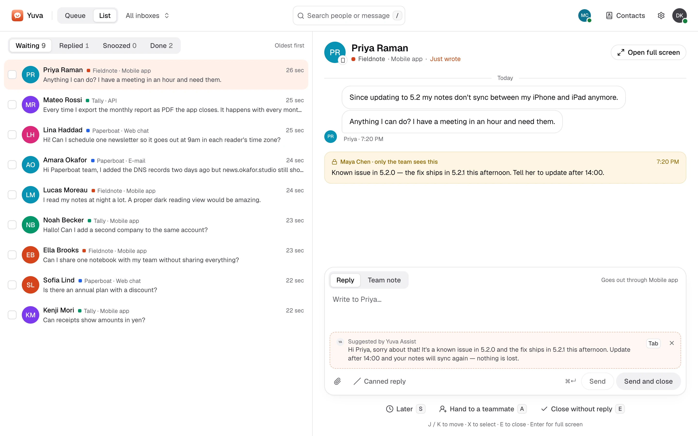
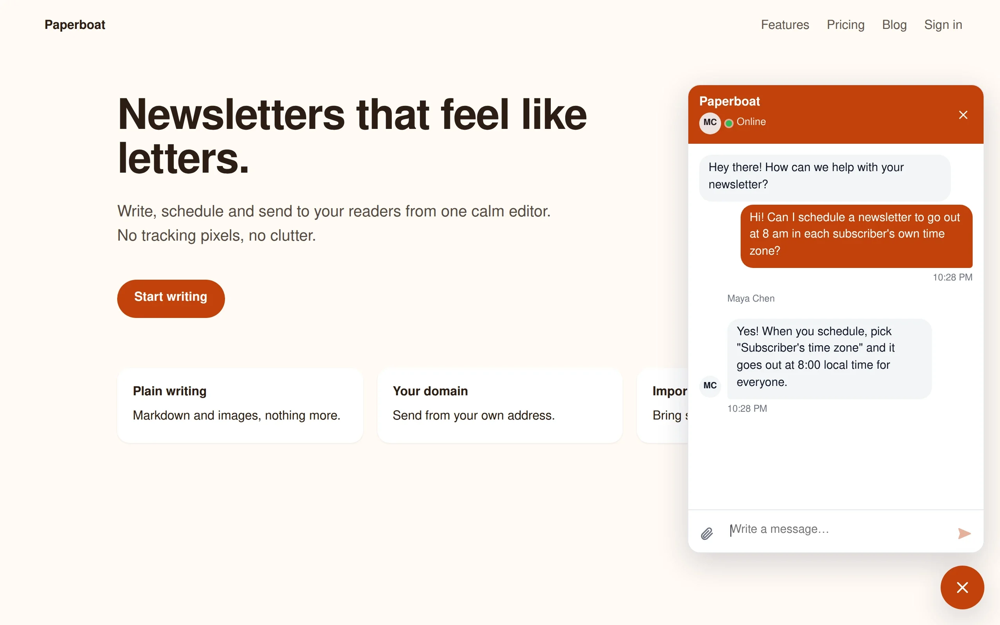

<div align="center">


# Yuva

**One inbox for every product you run.**

[Website](https://useyuva.com) · [Docs](docs/install.md) · [API](openapi/openapi.yaml) ·
[Releases](https://github.com/productdevbook/yuva/releases) · [Roadmap](docs/roadmap.md) ·
[X](https://x.com/useyuva)

[](https://github.com/productdevbook/yuva/releases)
[](https://github.com/productdevbook/yuva/actions/workflows/ci.yml)
[](LICENSE)
[](sdk/LICENSE)

</div>

Yuva is open-source customer messaging for teams that run several products. Support e-mail, live
chat, in-app messages and feedback from every product land in one shared inbox, next to the
newsletters, help center, status pages and analytics you send and publish from the same place.

You host it yourself: one Docker image and Postgres.

<picture>
  <source media="(prefers-color-scheme: dark)" srcset=".github/assets/panel-dark.webp">
  
</picture>

> [!WARNING]
> **Beta.** The API can still change before 1.0, so read the release notes before you
> [upgrade](docs/operations.md#upgrades). Database migrations run when the server starts: back up
> first. The code has not had an independent security audit.

## Features

| | |
|---|---|
| **Conversations** | One inbox per product with its own branding, language, hours and team. [E-mail](docs/email.md), [live chat](docs/widget.md), [in-app messages](docs/mobile.md) and app feedback in one thread, with notes, labels, mentions and bot drafts a member reviews. |
| **Team mail** | Shared addresses such as sales@ and people's own [mailboxes](docs/team-mail.md) in the same inbox, with drafts, send later, filters and search operators. Personal mailboxes are private, and you can delegate them. Yuva is the mailbox; it is not an IMAP server for mail apps. |
| **Reach** | [Mailing lists](docs/lists.md) with consent records and [imports](docs/importing.md), [e-mail designs](docs/designs.md) from templates, [broadcasts](docs/broadcasts.md) with approval and reports, and a [deliverability check](docs/deliverability.md). |
| **Publish** | [Help center](docs/help-center.md), [documentation pages](docs/documentation-pages.md), [status pages](docs/status-pages.md) on your own domain, a [roadmap board](docs/roadmap-board.md) and [What's new](docs/whats-new.md). |
| **Insights** | [Reports](docs/reports.md) on opened and closed conversations, response times, SLA and ratings, [cookieless analytics](docs/analytics.md) for websites and apps, and a [support report](docs/analytics-support.md) that ranks pages by the conversations they cause. |
| **Move in** | [Migrations](docs/migrate.md) of history and live mail from Gmail, Microsoft 365, Yandex, iCloud, Zoho, any IMAP server, Zendesk, Help Scout and Front. The old mailbox is only read. |
| **Build on it** | A REST [API](openapi/openapi.yaml) with scoped keys, signed [webhooks](docs/webhooks.md), [identity tokens](docs/identity.md), [headless](docs/headless.md) mode, and an [MCP server](docs/mcp.md) with OAuth for Claude, Cursor, VS Code and other assistants. |

Built with Go, Postgres and a React panel, shipped as one Docker image.

<table>
  <tr>
    <td width="50%">
      <picture>
        <source media="(prefers-color-scheme: dark)" srcset="site/src/assets/shots/panel-broadcast-en-dark.webp">
        
      </picture>
    </td>
    <td width="50%">
      <picture>
        <source media="(prefers-color-scheme: dark)" srcset="site/src/assets/shots/panel-analytics-en-dark.webp">
        
      </picture>
    </td>
  </tr>
  <tr>
    <td colspan="2" align="center">
      <picture>
        <source media="(prefers-color-scheme: dark)" srcset="site/src/assets/shots/widget-en-dark.webp">
        
      </picture>
    </td>
  </tr>
</table>

## Quick start

1. Write `compose.yaml` and `.env` from the [install guide](docs/install.md#quick-start-with-compose).
2. Start it:

   ```sh
   docker compose up -d
   ```

3. Create the first owner:

   ```sh
   docker compose exec yuva /yuva bootstrap --email you@example.com --workspace "Example"
   ```

4. Put it behind HTTPS and sign in with the code that arrives by e-mail.

On Kubernetes, install the Helm chart `oci://ghcr.io/productdevbook/charts/yuva`; see
[Kubernetes with Helm](docs/install.md#kubernetes-with-helm).

## SDKs and clients

| For | Install | Guide |
|---|---|---|
| Web: `<yuva-chat>`, headless client | `npm install useyuva` | [Web widget](docs/widget.md), [Headless](docs/headless.md) |
| React and shadcn/ui | `npx shadcn@latest add https://useyuva.com/r/yuva-discussions.json` | [shadcn registry](sdk/shadcn/README.md) |
| iOS and macOS | Swift package `https://github.com/productdevbook/yuva.git`, product `YuvaKit` | [Mobile SDKs](docs/mobile.md) |
| Android | `implementation("com.github.productdevbook:yuva:v0.3.0")` | [Mobile SDKs](docs/mobile.md) |
| Go | `go get github.com/productdevbook/yuva/sdk/go` | [Go SDK](sdk/go/README.md) |
| AI assistants | `/mcp` on your server, or `yuva.mcpb` from a release | [MCP](docs/mcp.md) |

Working projects are in [examples](examples).

## Privacy and security

- You host it: conversations, contacts and files stay on your servers.
- Analytics set no cookies and keep no cross-site identifiers; see
  [analytics privacy](docs/analytics-privacy.md).
- Every subscription records who consented, when and where, and lists export with that record.
- For assistants, customer text is marked as untrusted data, and their replies are drafts unless you
  allow sending.
- Report vulnerabilities privately as described in [SECURITY.md](SECURITY.md).

## Documentation

Guides, the API reference and examples are at [useyuva.com/docs](https://useyuva.com/docs/), and in
[docs/](docs) (also in [Turkish](docs/tr) and [German](docs/de)). How it is built:
[architecture](docs/architecture.md). What is next: [roadmap](docs/roadmap.md). What changed:
[GitHub Releases](https://github.com/productdevbook/yuva/releases).

## Community and contributing

Read [CONTRIBUTING.md](CONTRIBUTING.md) first; contributions are made under the [CLA](CLA.md).
For a local server with Postgres and Mailpit, which catches every mail it sends, run
`docker compose -f deploy/compose.yaml up -d`.
Ask questions and report bugs in [issues](https://github.com/productdevbook/yuva/issues), and follow
[@useyuva](https://x.com/useyuva) for news.

## License

The server and panel are [AGPL-3.0](LICENSE). The SDKs (`sdk/`) and the API contract (`openapi/`)
are [MIT](sdk/LICENSE), so you can ship them in closed-source apps. Details in
[LICENSING.md](LICENSING.md); name and logo in [TRADEMARK.md](TRADEMARK.md).

<div align="center">
<sub>“Yuva” is Turkish for nest, or home.</sub>
</div>
